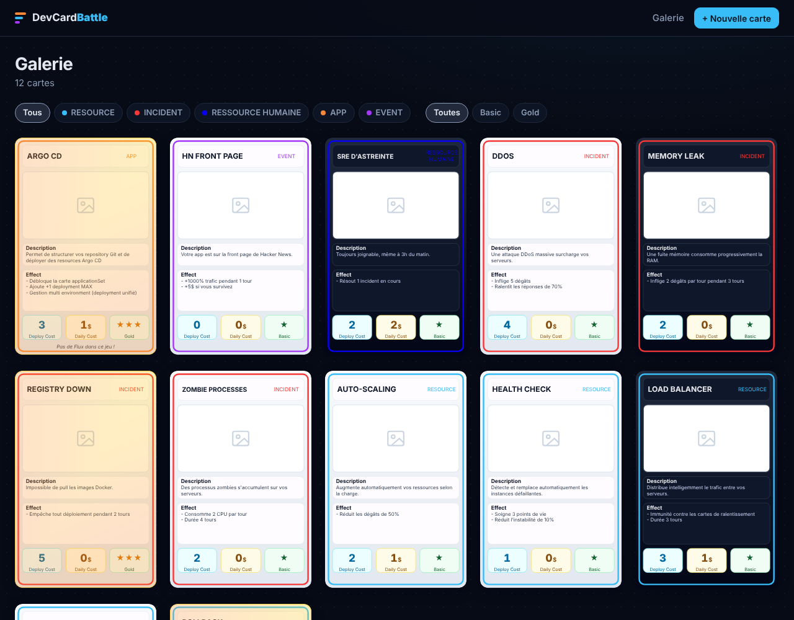

# DevCardBattle

Jeu de cartes stratégique sur le thème DevOps, inspiré de AWS Card Clash. À terme : des duels multijoueurs tour par tour, jouables depuis un navigateur.

Ce premier jalon pose la **collection de cartes** : une galerie web, un éditeur avec aperçu en direct, et une base SQLite qui stocke les cartes. Chaque carte est générée à partir de ses données, en reproduisant fidèlement le gabarit Figma.



## Démarrer

```bash
nix develop        # optionnel, fournit la toolchain Rust (voir flake.nix)
cargo run -p dcb-server
```

Puis ouvrir <http://127.0.0.1:3000>. Au premier lancement, la base est créée dans `data/dcb.db` et 12 cartes de démo sont ajoutées.

| Variable | Défaut | Rôle |
|---|---|---|
| `DATABASE_URL` | `sqlite://data/dcb.db` | Base SQLite (créée si absente) |
| `DCB_UPLOAD_DIR` | `data/uploads` | Dossier des illustrations envoyées |
| `DCB_BIND` | `127.0.0.1:3000` | Adresse d'écoute |
| `DCB_SEED` | `1` | `0` pour ne pas créer les cartes de démo |
| `RUST_LOG` | `dcb_server=info,tower_http=info` | Niveau de logs |

## Fonctionnalités

- **Galerie** : grille de toutes les cartes, filtres par type et par rareté.
- **Éditeur** : création et modification avec aperçu de la carte mis à jour pendant la saisie, compteurs de caractères calés sur la place disponible dans la carte, upload d'illustration (PNG, JPEG, WebP, GIF, 5 Mo max).
- **Fiche carte** : affichage en grand, modification, suppression (l'illustration est supprimée avec la carte).
- **API JSON** pour les futurs clients du jeu :
  - `GET /api/cards` (filtres `?type=incident&rarity=gold`)
  - `GET /api/cards/{id}`
  - `GET /api/meta` : types, couleurs, skins, raretés et limites de saisie

## La carte

Reproduite depuis le composant `card` du fichier Figma DevCardBattle (374×574), en trois couches :

| Couche | Valeurs |
|---|---|
| Type (bordure + badge) | Resource `#38bdf8`, Incident `#f83838`, Ressource humaine `#0800f6`, App `#f88838`, Event `#a538f8` |
| Skin | Light, Dark |
| Rareté | Basic, Gold (overlay doré du Figma + reflet animé) |

Le rendu est en HTML/CSS (`crates/dcb-server/static/card.css`) : la carte est dessinée à ses cotes Figma puis mise à l'échelle, donc le même code sert à la galerie, à l'aperçu et à la fiche.

**Ajouter un type de carte** : une variante dans `CardType` (`crates/dcb-core/src/lib.rs`, avec sa couleur) et une ligne `[data-type]` dans `card.css`. Aucune migration : les types sont stockés en texte.

## Architecture

```
crates/
  dcb-core/     Modèle de domaine partagé (Card, CardType, Skin, Rarity, validation)
  dcb-server/   Serveur axum : pages HTML (askama + htmx), API JSON, SQLite (sqlx)
    templates/  Pages et partial de carte
    static/     CSS de l'app et de la carte, htmx embarqué
migrations/     Schéma SQLite, appliqué au démarrage
```

Choix techniques :

- **Rendu serveur + htmx** plutôt qu'une SPA : pas de toolchain JavaScript ni de WASM à maintenir pour la partie collection. Les assets sont embarqués dans le binaire, un seul exécutable à déployer.
- **`dcb-core` séparé** pour que le futur moteur de duel (et un éventuel client Bevy compilé en WASM) réutilise exactement les mêmes types que la base et l'API.
- **SQLite** pour démarrer. Le passage à PostgreSQL pour le jeu en ligne ne touche que `db.rs` et les migrations.

## Développement

```bash
cargo test --all                       # unitaires + tests HTTP de bout en bout
cargo clippy --all-targets -- -D warnings
cargo fmt --all
```

La CI GitHub Actions lance ces trois commandes à chaque push et pull request.

## Prochaines étapes

- Effets structurés (type, valeur, durée) en plus du texte libre, pour que le moteur puisse les appliquer
- Deck builder
- Moteur de duel et parties en ligne via WebSocket
- Comptes joueurs
